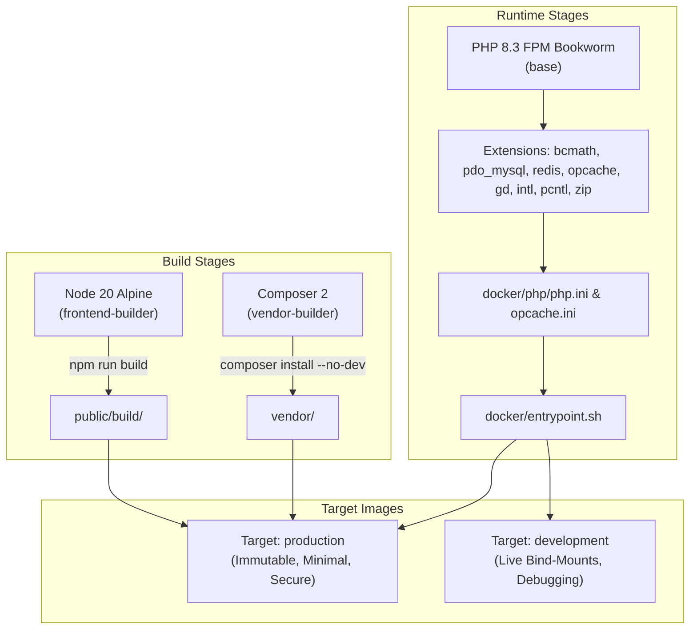
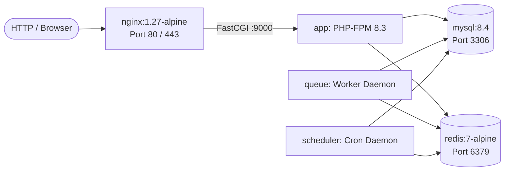

# Day 29: Multi-Stage Docker Production Deployment & CI Pipeline

## 📋 Executive Summary

Day 29 delivers a fully containerized, enterprise-grade deployment stack for the **Laravel Multi-Vendor Marketplace**. This includes:
1. A **5-stage multi-stage Dockerfile** separating frontend compilation, PHP dependency installation, base runtime extensions, immutable production images, and local development environments.
2. A complete **Docker Compose orchestration topology** declaring `app`, `queue`, `scheduler`, `mysql` (aliased as `db`), `redis`, and production `nginx` reverse proxy services.
3. A **role-based runtime entrypoint** (`docker/entrypoint.sh`) supporting deterministic worker processes, cache pre-warming, and permissions hardening.
4. An enhanced **GitHub Actions CI/CD pipeline** running automated code style audits (`Pint`), the complete test suite (337 tests, 2,021 assertions), frontend asset compilation, and multi-stage Docker build audits.

---

## 🏗️ Multi-Stage Docker Architecture

The `Dockerfile` employs multi-stage caching to minimize final image size, isolate sensitive build tools, and enforce immutable production artifacts:



### Stage Breakdown

| Stage | Base Image | Purpose | Output / Artifacts |
|---|---|---|---|
| **1. `frontend-builder`** | `node:20-alpine` | Compiles Vite scripts and Tailwind CSS styles. | Production bundles in `/app/public/build` |
| **2. `vendor-builder`** | `composer:2` | Installs optimized, non-development PHP dependencies (`--no-dev --optimize-autoloader`). | Production `/app/vendor` directory |
| **3. `base`** | `php:8.3-fpm-bookworm` | Installs essential system libraries, PHP extensions (`pdo_mysql`, `redis`, `opcache`, `bcmath`, `pcntl`, `zip`, `gd`), and configures production PHP INI directives. | Shared base runtime layer |
| **4. `production`** | `base` | Merges code, vendor libraries, compiled frontend assets, and sets strict `www-data:www-data` ownership on storage. | Deployable production container |
| **5. `development`** | `base` | Enables error display and hot reload for local development volume mounts. | Developer workstation container |

---

## 🐳 Docker Compose Topology

The marketplace deployment is split into dedicated, single-responsibility microservices across development (`docker-compose.yml`) and production (`docker-compose.prod.yml`):



### Service Specifications

1. **`app`**:
   - Handles API requests and the interactive marketplace explorer.
   - Development: Exposes port `8000:8000` running `php artisan serve`.
   - Production: Runs PHP-FPM on port `9000`, fronted by Nginx.
   - Built-in health check querying `GET /up` with automatic restart policies.

2. **`queue`**:
   - Runs `php artisan queue:work --queue=default,notifications,reports --sleep=3 --tries=3 --max-time=3600`.
   - Processes asynchronous vendor report exports, notifications, and mail delivery.
   - Depends on healthy `mysql` and `redis` instances.

3. **`scheduler`**:
   - Runs `php artisan schedule:work` daemon.
   - Executes scheduled cleanup tasks registered in `routes/console.php`:
     - `sanctum:prune-expired --hours=24` (Daily token eviction)
     - `queue:prune-failed --hours=48` (Failed job retention)
     - `queue:prune-batches --hours=48` (Batch job cleanup)
     - `model:prune` (Soft-deleted records cleanup)

4. **`mysql` (aliased as `db`)**:
   - Image: `mysql:8.4`.
   - Healthcheck: `mysqladmin ping` every 5 seconds.
   - Persistent volume: `mysql_data`.
   - Network aliases: `[db, mysql]`, allowing seamless resolution regardless of `.env` configuration.

5. **`redis`**:
   - Image: `redis:7-alpine`.
   - Healthcheck: `redis-cli ping`.
   - Persistent volume: `redis_data` with `--appendonly yes` persistence in production.

6. **`nginx`** (Production Stack):
   - High-performance reverse proxy with Gzip compression, FastCGI caching, and security headers (`X-Frame-Options`, `X-Content-Type-Options`, `X-XSS-Protection`).
   - Serves static assets (`/var/www/html/public`) directly from volume with long-lived client caching headers.

---

## ⚙️ Container Entrypoint & Role Dispatcher

The custom entrypoint script located at `docker/entrypoint.sh` inspects the container's execution role and applies necessary boot-time tasks:

```bash
case "$ROLE" in
    app)        # Starts web server (FPM mode or CLI serve)
    queue)      # Starts queue worker daemon
    scheduler)  # Starts scheduled tasks daemon
    supervisor) # Starts supervisord process manager
    *)          # Executes custom commands (e.g. php artisan migrate)
esac
```

Key runtime duties performed before service launch:
- Ensures storage directory hierarchy exists (`storage/framework/cache/data`, `storage/framework/sessions`, `storage/framework/views`, `storage/logs`).
- Repairs Unix ownership (`chown -R www-data:www-data`).
- In production mode (`APP_ENV=production`), warms up framework caches:
  - `php artisan config:cache`
  - `php artisan route:cache`
  - `php artisan view:cache`
  - `php artisan event:cache`

---

## 🚀 Quickstart & Usage Guide

### Local Development with Docker

```bash
# 1. Clone and enter repository
cd multi-vendor-marketplace

# 2. Copy environment file
cp .env.example .env

# 3. Build and boot development stack
docker compose up -d --build

# 4. Generate app key and run migrations with seed data
docker compose exec app php artisan key:generate
docker compose exec app php artisan migrate --seed --class=MarketplaceSeeder

# 5. Open interactive marketplace in browser
# http://localhost:8000/
```

### Production Deployment Stack

```bash
# 1. Review production environment variables
export APP_KEY=$(php artisan key:generate --show)
export MYSQL_ROOT_PASSWORD=secure_root_password
export DB_PASSWORD=secure_marketplace_password

# 2. Start production stack with Nginx
docker compose -f docker-compose.prod.yml up -d --build

# 3. Run production migrations
docker compose -f docker-compose.prod.yml exec app php artisan migrate --force
```

---

## 🔄 GitHub Actions CI/CD Pipeline

The updated GitHub Actions workflow (`.github/workflows/ci.yml`) runs on every push and pull request across three dedicated jobs:

1. **`lint` (Laravel Pint & Composer Audit)**:
   - Enforces PSR-12 code style via `vendor/bin/pint --test`.
   - Validates `composer.json` and `composer.lock` consistency (`composer validate --strict`).
   - Uses Composer dependency caching (`actions/cache`).

2. **`test` (PHPUnit & Frontend Build)**:
   - Sets up PHP 8.3 and Node 20.
   - Compiles Vite frontend assets (`npm ci && npm run build`).
   - Executes the complete test suite (`php artisan test`) covering 337 tests and 2,021 assertions.

3. **`docker` (Multi-Stage Build & Compose Audit)**:
   - Validates `docker-compose.yml` and `docker-compose.prod.yml` configuration syntax.
   - Builds both `development` and `production` Docker stages via Buildx to verify image assembly.
