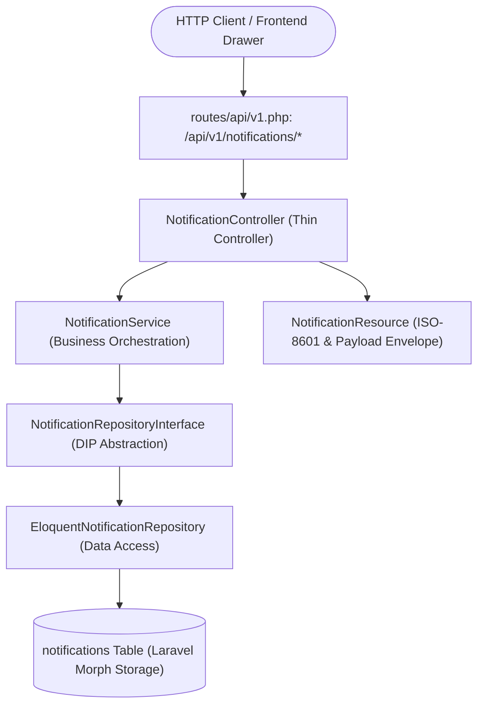

# Day 30: In-App Notification Center, Repository Abstraction & UI Explorer

## 📋 Executive Summary

Day 30 delivers a complete, production-grade **In-App Notification Center** for the **Laravel Multi-Vendor Marketplace**. While earlier milestones established event listeners and queued notification dispatchers (e.g. `OrderPlaced`, `OrderPaid`, `OrderShipped`, `VendorApproved`) writing to the database `notifications` table, Day 30 introduces the domain, service, repository, and controller layers enabling customers, vendors, and administrators to query, filter, count, mark as read, and dismiss real-time notifications with full data isolation and an interactive frontend explorer.

---

## 🏗️ Architectural Overview & SOLID Adherence

### SOLID Principles in Action:
- **Single Responsibility (SRP)**: `NotificationController` handles HTTP serialization and status codes; `NotificationService` encapsulates business logic for notification workflows; `EloquentNotificationRepository` handles Eloquent queries; `NotificationResource` handles consistent JSON formatting.
- **Open/Closed (OCP)**: New notification channels or storage drivers can be added by implementing `NotificationRepositoryInterface` without touching controllers or services.
- **Liskov Substitution (LSP)**: `EloquentNotificationRepository` implements `NotificationRepositoryInterface` cleanly without altering caller expectations.
- **Interface Segregation (ISP)**: `NotificationRepositoryInterface` exposes only focused methods (`forUser`, `unreadCountForUser`, `findByIdForUser`, `markAsRead`, `markAllAsRead`, `deleteForUser`).
- **Dependency Inversion (DIP)**: `NotificationService` and `AppServiceProvider` depend exclusively on `NotificationRepositoryInterface`, bound in the service container.

---

## 🔌 API Endpoints Specification

| Method | Endpoint | Auth | Description |
|---|---|---|---|
| `GET` | `/api/v1/notifications` | Sanctum (`auth:sanctum`) | Paginated notifications list with optional `?unread=1` / `?unread=0` filter |
| `GET` | `/api/v1/notifications/unread-count` | Sanctum (`auth:sanctum`) | Returns `{ "unread_count": <int> }` for live bell badge |
| `PATCH` | `/api/v1/notifications/{id}/read` | Sanctum (`auth:sanctum`) | Marks an individual notification as read (idempotent, isolated to owner) |
| `POST` | `/api/v1/notifications/read-all` | Sanctum (`auth:sanctum`) | Bulk marks all unread notifications for authenticated user as read |
| `DELETE` | `/api/v1/notifications/{id}` | Sanctum (`auth:sanctum`) | Dismisses / deletes a notification row |

*Note: All endpoints are also mirrored under `/api/notifications/...` for backward compatibility.*

---

## 🖥️ Interactive Platform Explorer Integration

The interactive frontend explorer (`resources/views/welcome.blade.php`) now features:
1. **Header Bell Badge**: An animated notification bell with real-time unread count pill badge (`#notification-badge-count`).
2. **Glassmorphic Notification Drawer**: Slide-over drawer with tabs ("All" / "Unread Only"), individual "Mark Read", "Dismiss", and bulk "Mark All Read".
3. **Persona-Aware Synchronization**: Automatically fetches and scopes notifications when switching personas (`Customer`, `Vendor`, `Admin`) and immediately refreshes when placing orders or shipping packages.

---

## 🧪 Automated Testing Sprint

Feature test suite in `tests/Feature/NotificationTest.php`:
- ✅ `test_unauthenticated_user_cannot_access_notifications`: Enforces 401 Unauthorized for guests.
- ✅ `test_user_can_list_notifications_with_standard_envelope`: Asserts JSON structure, metadata, pagination, and humanized timestamps.
- ✅ `test_user_can_filter_unread_notifications`: Tests `?unread=1` and `?unread=0` filtering.
- ✅ `test_user_can_get_accurate_unread_count`: Verifies counter endpoint accuracy.
- ✅ `test_user_can_mark_notification_as_read`: Validates single notification mutation.
- ✅ `test_marking_already_read_notification_remains_successful`: Confirms idempotent state updates.
- ✅ `test_user_cannot_access_or_mutate_another_users_notification`: Confirms cross-tenant isolation (returns 404).
- ✅ `test_user_can_mark_all_notifications_as_read`: Tests atomic bulk updates.
- ✅ `test_user_can_delete_notification`: Verifies deletion and database disappearance.
- ✅ `test_notifications_are_accessible_via_unversioned_fallback`: Ensures backward compatibility.
- ✅ `test_real_checkout_flow_populates_notifications_for_customer_and_vendor`: End-to-end integration test verifying order checkout writes and notifications retrieval.

**Overall Test Suite Status:**
- Total tests: **350 passed** (2,122 assertions).
- Zero linting errors (`vendor/bin/pint --test` passed).
- Frontend assets verified (`npm run build` compiled cleanly).
